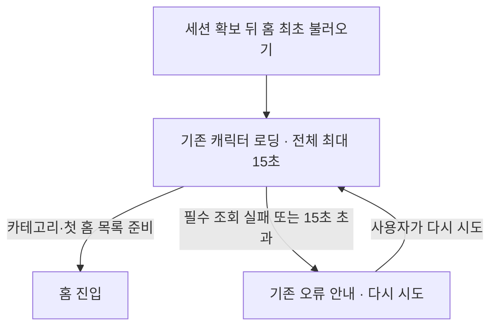

# 홈 최초 불러오기 복구

2026-10-24 사용자가 정책 질문 Q1–Q5와 최종 흐름을 확정한 설계입니다. 구현·배포 완료를 뜻하지 않습니다.
기준은 main `5671e79a6c3451068cf053d185a9334fd9f3144c`이며,
작업 브랜치는 `docs/home-loading-recovery`입니다. 이미지 보관 PR #75와 분리합니다.
확정 명세는 [GitHub 이슈 #76](https://github.com/clip-back/clipback/issues/76)에서 관리합니다.
하위 작업은 [필수 목록 준비 시 홈 진입 #77](https://github.com/clip-back/clipback/issues/77),
[전체 15초 제한과 안전한 수동 재시도 #78](https://github.com/clip-back/clipback/issues/78)입니다.
#78은 #77 완료 후 시작하며 두 이슈 모두 `ready-for-agent`입니다.

## 확정된 범위

- **Q1 / 확정:** 세션 확보 뒤 홈 최초 진입과 실패 후 재시도부터 다룹니다.
  앱 재실행·로그인 후 최초 홈 진입을 포함합니다. 홈에 들어간 뒤 검색·저장·추천 재조회는 별도 범위입니다.
- **Q2 / 확정:** 실패 뒤 사용자가 ‘다시 시도’를 눌렀을 때만 재요청합니다.
  연결이 돌아왔다는 이유로 자동으로 재시도하지 않으며, 재시도 중 중복 입력을 막습니다.
- **Q3 / 확정:** 한 번의 홈 최초 불러오기에 전체 15초의 대기 상한을 둡니다.
  요청마다 시간을 다시 부여하지 않습니다. 필수 목록을 준비하지 못하면 기존 오류 화면으로 전환합니다.
- **Q4 / 확정:** 기존 ‘저장한 콘텐츠를 불러오지 못했어요.’와 ‘다시 시도’ 화면을 재사용합니다.
  재시도 동안 기존 Figma 캐릭터·세 점 로딩을 표시합니다. 첫 구현에 L-M01의 새 외형을 적용하지 않습니다.
- **Q5 / 확정:** 카테고리와 첫 홈 콘텐츠 목록이 준비되면 홈 진입을 허용합니다.
  사용자 정보·통계의 지연이나 인증 실패가 아닌 조회 오류 때문에 전체 복구 화면으로 보내지 않습니다.
  실제 인증 만료는 기존 인증 복구 절차를 따르며, 통계 확인 실패의 0 표시 문제는 별도 작업입니다.
- 용어는 [용어집](../../GLOSSARY.md)을 따릅니다. 위 다섯 결정은 사용자가 추천안을 선택했습니다.

## 한 번의 시도와 화면 전환

- 시간은 세션 확보 뒤 홈 준비를 시작할 때부터 계산합니다. 토큰 저장소 읽기나 소셜 인증의 전체
  시간을 새 홈 로딩 시간으로 합치지 않습니다. 인증 갱신이 발생해도 같은 시도의 시간을 다시 늘리지 않습니다.
- 재시도는 새로운 15초 시도로 시작하고 카테고리·첫 홈 목록을 다시 확인합니다.
  정상 응답이면 15초를 채우지 않고 진입하며, 기존 최소 로딩 표시 900ms는 유지합니다.
- 빈 홈 목록도 정상 응답이면 준비 완료입니다. 뒤쪽 페이지를 모두 읽을 때까지 기다리지 않습니다.
- 사용자 정보·통계는 홈 진입을 막지 않는 후속 확인으로 다룹니다. 미확인 계정은 기존
  ‘계정 정보 확인 중’ 표현을 사용하고, 실제 계정 정보가 도착하면 같은 계정인지 확인한 뒤 반영합니다.
- 실패한 이전 시도의 응답은 새 시도나 계정 상태를 덮어쓰지 않습니다. 후속 확인도 끝없이 남지 않게
  종료·늦은 응답·계정 변경을 검증합니다. 단순히 대기 Future에 시간 제한만 붙이는 방식은 완료가 아닙니다.

## 유지하는 현재 동작

- 기존 전면 캐릭터·세 점 로딩의 적용 범위와 OS 안전 영역을 유지합니다.
  토큰 읽기·소셜 인증 대기·신규/게스트 온보딩·계정 연결을 같은 화면으로 일괄 바꾸지 않습니다.
- 통신 실패만으로 세션을 지우거나 새 게스트를 발급하지 않습니다. 인증 갱신·최종 401·
  Apple 계정 확인·로컬 세션 삭제 복구는 기존 보안 동작을 유지합니다.
- 홈 필수 데이터인 카테고리·홈 목록과, 현재 인증 실패가 아닌 조회 오류를 허용하는 사용자 정보·통계를 구분합니다.
  통계 실패를 실제 0처럼 표시하는 문제는 별도 UI/UX 후보입니다.

## 코드·디자인에서 확인한 제약

- 현재 일반 JSON 요청에는 명시적 종료 시간이 없습니다. 카테고리→홈 목록→사용자 정보→통계를
  순서대로 기다리므로 무응답에서 홈 최초 불러오기가 끝나지 않을 수 있습니다.
- [기존 복구 화면](../../frontend/lib/features/auth/session_restore_screen.dart)은 홈 실패뿐 아니라
  토큰 읽기·무효 세션의 로컬 삭제 실패·첫 성공 뒤 재조회에도 쓰입니다. 홈 복구 화면의 변경을
  이 공용 화면의 모든 상태에 적용하지 않습니다.
- 기존 계정 세대 보호 외에, 시간 제한으로 끝낸 이전 시도의 늦은 응답이 같은 계정의 새 시도를
  덮어쓰지 않는지도 검증해야 합니다. Future 대기에 시간 제한만 붙이는 것으로 완료 판단하지 않습니다.
- 기존 최초 로딩 기준은 [Figma 맞춤 계획](../figma-ui-alignment-plan.md#figma-current-09)과
  [당시 구현 이력](../history/2026-10-18-initial-loading.md)을 따릅니다.
- 2026-10-24 Figma의 [L-M01 공통 연결 오류·재시도](https://www.figma.com/design/svNWsTFh8Ws1Mpt8XQIcrN/?node-id=120-4881)
  컨텍스트·화면을 새로 조회했습니다. Q4에서 첫 구현은 기존 오류 화면을 재사용하기로 정했습니다.
  L-M01의 별도 외형·뒤로가기·상태 상자는 후속 디자인 결정이며, 예제의 ‘오프라인’ 표기를
  모든 조회 실패에 사실처럼 표시하지 않습니다.

## 기존 화면과 복구 동선

- 복구 화면은 기존 오류 안내와 ‘다시 시도’를 유지합니다. 조회 실패를 오프라인으로 단정하거나,
  새 상태 진단 상자·로그아웃·취소·뒤로가기 동작을 추가하지 않습니다.
- Android 시스템 복귀와 공용 복구 화면의 세션 읽기·세션 삭제 재시도는 기존 규칙을 유지합니다.
  홈 복구가 이 상태들의 처리 목적을 바꾸지 않도록 검사합니다.

## 검증할 사용자 결과

- 필수 조회 무응답은 시도 시작 15초에 복구 상태로 끝나고, 정상 응답은 홈으로 진입합니다.
- 카테고리와 홈 첫 목록이 준비되면 사용자 정보·통계의 무응답·실패에도 홈 진입을 허용합니다.
- 수동 재시도 한 번이 한 시도만 시작하며, 자동 재요청은 발생하지 않습니다.
- 실패·시간 초과 뒤 도착한 이전 응답이 복구 화면이나 새 시도를 덮어쓰지 않습니다.
- 조회 실패에서 세션·저장한 콘텐츠를 유지하며 기존 인증 만료·계정 변경 동작을 보존합니다.
- 화면 변경은 확정한 Figma를 기준으로 iOS·Android의 전후 화면·동작을 검증합니다.

정책과 코드 확인의 출처·문서 검증은 [설계 인터뷰 이력](../history/2026-10-24-home-loading-recovery-design.md)에 기록합니다.
확정한 흐름을 구현 명세의 기준으로 사용합니다. 아직 제품 코드는 바꾸지 않았습니다.
