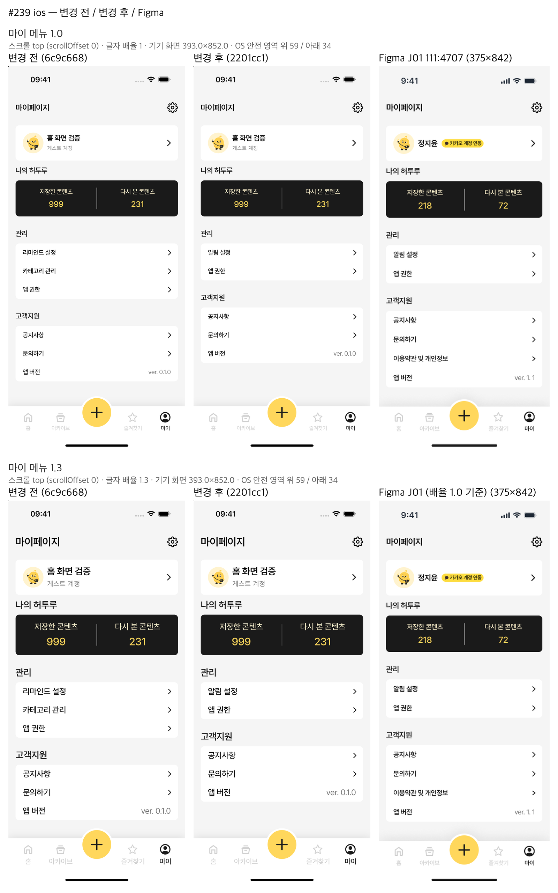
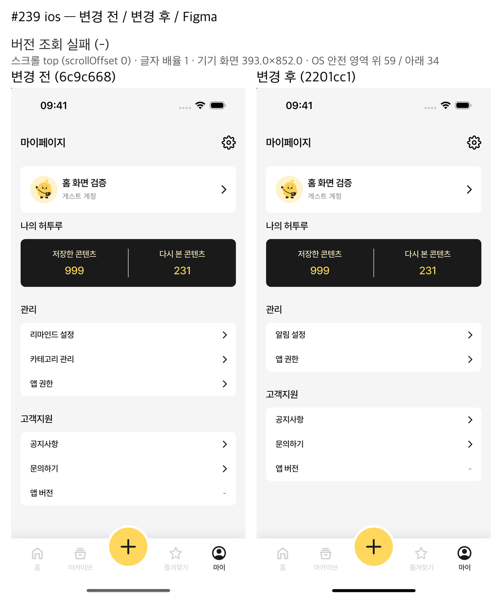
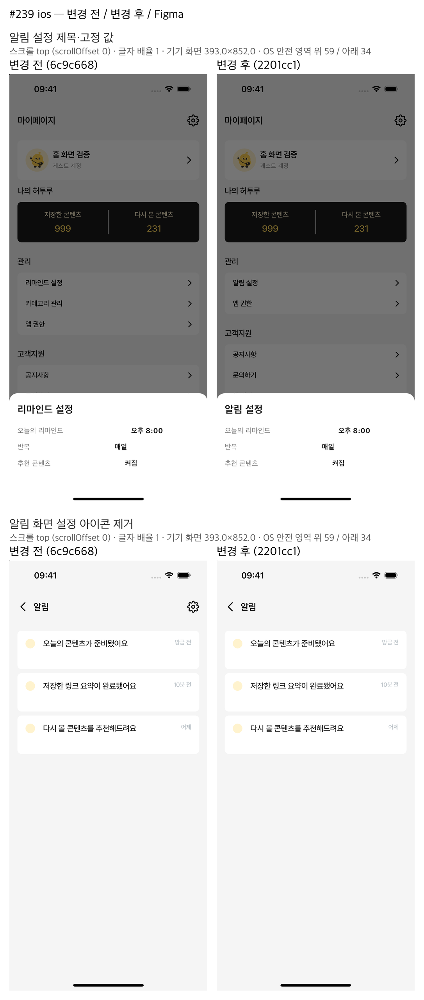
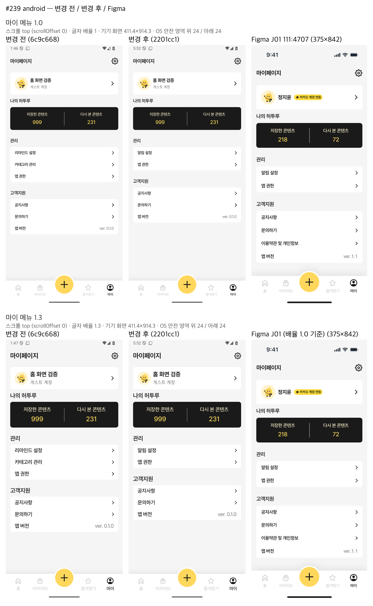
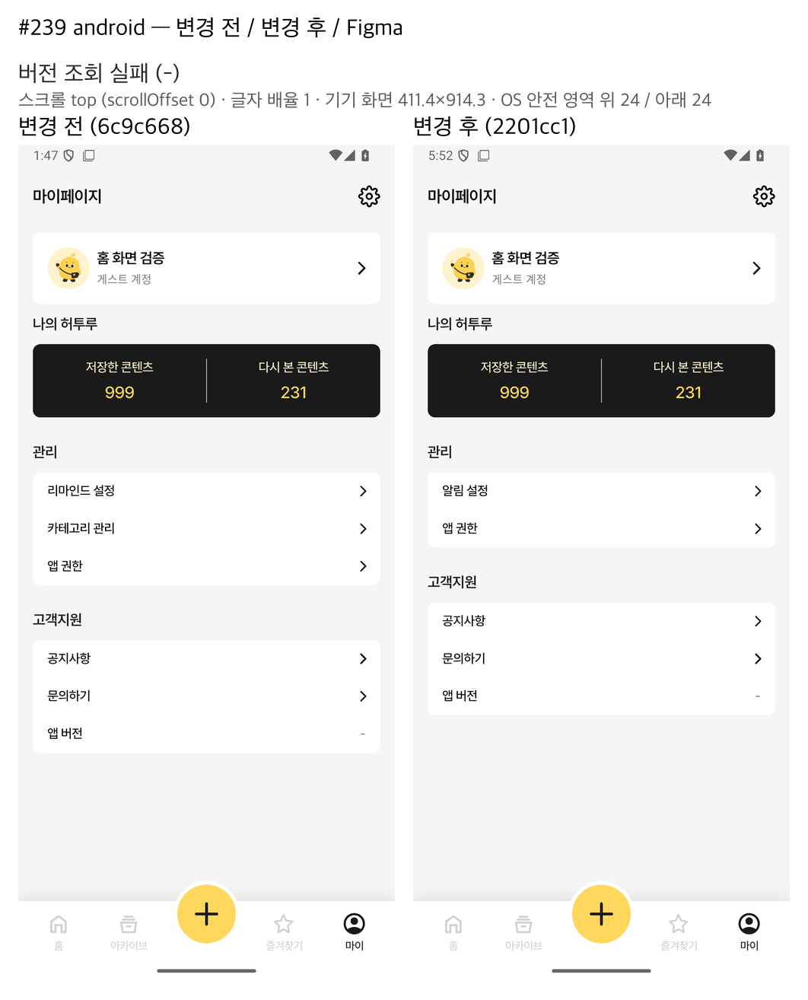
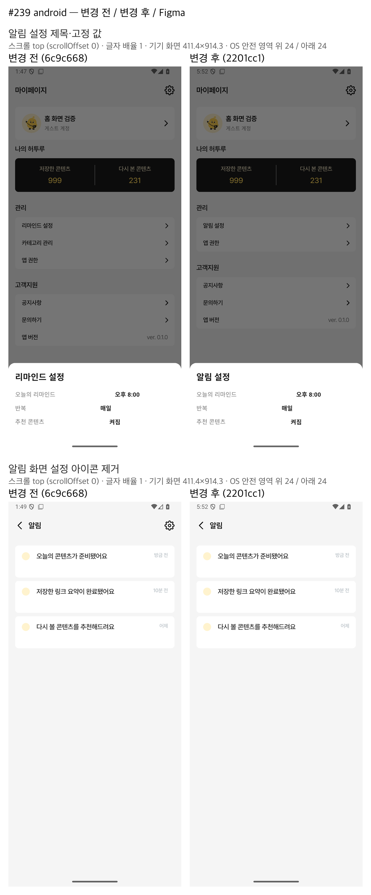

# 마이 메뉴 Figma 목록·버전 팝업 제거 (#239)

2026-11-05 작업 기록. [이슈 #239](https://github.com/clip-back/clipback/issues/239)의 단일 이슈 구현이다.
자동 검사와 양 플랫폼 변경 후 촬영은 끝났으며 **사용자 시각 판정은 대기 중**이다. 이슈는 열림 상태를 유지하며, 이 기록은 배포·PR 게시 또는 사용자 승인을 뜻하지 않는다.

## 결정과 구현 범위

사용자 결정은 “(27) 앱 버전 팝업: 없애기”, “(23) 리마인드 설정: 마이페이지는 피그마에 있는 목록으로 변경해줘”, “이슈는 모두 추천대로”다.

| 항목 | 반영한 동작 |
| --- | --- |
| 관리 | ‘알림 설정 → 앱 권한’. 마이의 ‘카테고리 관리’ 줄과 전용 callback 제거 |
| 고객지원 | ‘공지사항 → 문의하기 → 앱 버전’. 기존 목적지와 NoticeSheet fallback 유지 |
| 알림 설정 | 기존 ReminderSheet 제목을 ‘알림 설정’으로 변경. 마이 한 곳에서만 열며 고정 값 ‘오늘의 리마인드 오후 8:00 / 반복 매일 / 추천 콘텐츠 켜짐’ 유지 |
| 알림 화면 | 설정 아이콘·터치 영역·접근성 진입과 루트 설정 callback 제거. 홈 → 알림 → 뒤로가기와 목록 상태 유지 |
| 앱 버전 | 설치 버전 `ver. X.Y.Z`, 조회 실패 `-` 유지. 화살표·탭·접근성 tap action 없는 표시 전용. AppVersionSheet와 미사용 참조 제거 |
| 다른 진입 | 프로필·상단 계정 관리·하단 탭·공지·문의·권한, 아카이브·즐겨찾기의 카테고리 관리 경로 유지 |

실제 알림 설정을 변경할 수 없다는 23번 제약은 남는다. 실제 푸시·리마인드 API, 권한 변경, 운영 문의 접수·공지 데이터 기능은 이번 범위가 아니다.
‘이용약관 및 개인정보’ 줄은 운영 주소 확정 전 추가하지 않았고 메뉴는 기존 14px를 유지했다. J01의 약관 줄·15px와의 차이는 승인된 잔여 차이다.
현재 안내는 [Figma 계획](../figma-ui-alignment-plan.md#figma-current-16)과 [프론트 README](../../frontend/README.md#마이-메뉴와-알림-설정)를 따른다. 과거 이력은 덮어쓰지 않았다.

## 커밋과 리뷰

| 커밋 | 내용 |
| --- | --- |
| `027ca56` | 시작 `6c9c668`에서 메뉴·진입·버전 팝업 변경 및 관련 테스트·현재 문서 갱신 |
| `6e8051a` | 전체 검사에서 발견한 옛 마이 카테고리 기대값 보완 |
| `3943ff0` | main `637e209`의 사진 저장 재시도 수정 #235/#244 병합 |
| `2201cc1` | 병합 후 새 테스트 fixture의 `String? submissionKey` callback 인자 연결. 제품·단언 변경 없음 |

리뷰 파일은 로컬 `.utmp/review-239.md`, 코드 검토 범위는 `6c9c668..027ca56`이다. Standards·Spec 모두 높음/중간/낮음 지적 0건이다.
리뷰어는 전체 검사를 실행하지 않았고 기존 로그·커밋 diff로 판단했다. 후속 `6e8051a`·`2201cc1`의 승인 범위 내 테스트 보완은 감독이 diff를 직접 확인했다. 단일 이슈이므로 최종 리뷰는 티켓 리뷰로 대신했다.

### 기존 테스트 교체 이유

없어진 동작을 요구하는 기대값과 그 전용 테스트 이름만 새 비노출·비활성·단일 진입 단언으로 교체하도록 승인받았다.

| 대상 | 변경 이유·보존 범위 |
| --- | --- |
| app_version_display / my_screen_figma / my_preview | 버전 팝업·옛 메뉴·마이 관리 진입을 새 목록·팝업 부재로 대체. 설치 버전·실패값·계정/통계 오류·다른 시트·탭/save 단언 유지 |
| notification_navigation / notification_list_content / notification_alignment_fixture·preview | 설정 아이콘·callback 존재를 부재/옛 위치 무동작으로 대체. 목록·뒤로가기·인증 취소/세션 clear/generation 보호 유지 |
| notice_navigation / phone_width / category_delete / system_back 및 관련 preview | 삭제된 My 관리 fixture를 아카이브의 기존 진입으로 연결. 계정·공지·키보드·삭제/실패·scroll 단언 유지. 관리 복귀 대상은 해당 진입인 아카이브로 변경 |
| session_restore / feed_pagination | 전체 검사에서 발견한 My 카테고리 존재/왕복 기대를 부재·알림 설정 존재·즐겨찾기 관리 왕복으로 대체. 실패/재시도 호출 수·0 복구·세션·다른 페이지 단언 유지 |
| content_mutation / safe-area·확대 fixture | 새 메뉴 finder 또는 제거된 생성자 인자 연결만 보완. 기대값·이름 유지 |
| my_menu_decision | 두 그룹 순서·삭제 줄·약관 줄 부재, 정상/실패 버전의 tap/button semantics 부재·route/offset 보존, 알림 설정 진입 부재, 읽기 전용 값·복귀 확인을 추가 |

최소 폭 320px에서 실제 Pretendard Regular/Medium/SemiBold를 로드했다. 글자 배율 1.0·1.1·1.2·1.3은 각각 독립 테스트이며 ‘알림 설정’과 `ver. 123.456.789`의 자연 폭·할당 폭·높이·잘림을 검사했다. 관련 오류·인증·계정·기존 목적지 단언을 무관하게 완화하지 않았다는 감독/검수 확인과 구분해 기록한다.

## 최종 자동 검증

병합 `3943ff0`에 callback fixture를 보완한 트리를 검사했고 그 트리가 `2201cc1`이다. 아래는 2026-11-05 17:28–17:34 KST의 **병합 후 최종 실행**이다.
저장소 루트에서 공용 `busy.sh --wait` 대기 후 `busy.sh &&`로 실행했고, Perl exec 래퍼는 600초 제한만 적용했다.

```bash
python3 ~/.heoturu-agents/verify.py --log-dir .utmp/ticket-239/merged-final/retry-1
```

실제 결과 파일은 `.utmp/ticket-239/merged-final/retry-1/verify-result.txt`, 단계 로그 폴더는 `.utmp/ticket-239/merged-final/retry-1/20261105T172823-35bf21d9498b/`다. 다음은 실제 로그/결과 파일 원문이며 skip 사유의 생략 기호도 verify 출력 그대로다.

```text
2048 passed, 46 skipped, 3 warnings in 165.55s (0:02:45)
02:39 +2907: All tests passed!
pytest skip: 45 tests/deployment (RUN_DOCKER_RECOVERY_TESTS=1 and a labelled local image are … 외 6종)
pytest skip: 1 tests/integration (CLIPBACK_IMAGE_TEST_S3_ENDPOINT is required for the local s…)
VERIFY result=PASS scope=all checks=11 failed=0 logs=/Users/leehyeongyu/orca/workspaces/Clipback/my-page-figma-list/.utmp/ticket-239/merged-final/retry-1/20261105T172823-35bf21d9498b
```

11개 단계는 backend ruff·compileall·test/maintenance DB별 Alembic upgrade/check·pytest, 앱 pub-get·format·analyze·test이며 모두 통과했다. 로그는 같은 폴더의 `backend-ruff.log`, `backend-compileall.log`, `backend-alembic-upgrade-test.log`, `backend-alembic-check-test.log`, `backend-alembic-upgrade-maint.log`, `backend-alembic-check-maint.log`, `backend-pytest.log`, `app-pub-get.log`, `app-format.log`, `app-analyze.log`, `app-test.log`에 남아 있다.
Docker deployment와 별도 S3 endpoint integration의 skip은 통과로 세지 않는다. 로컬 DB/대역 검증이며 원격 CI·실제 OAuth·운영 서버·실기기 검증은 아니다.

병합 후 촬영 진입점은 frontend에서 `flutter test --no-pub ../.utmp/ticket-239/state_preview_check_test.dart`로 확인했다. `.utmp/ticket-239/preflight-after-merged.log`의 2건 통과는 컴파일·메모리 API 부팅과 metrics 변경 시 route/controller/input 보존 근거다. 기본 phase=unknown의 preflight이므로 실제 메뉴 탭/촬영 동작 확인으로 대신하지 않는다.

과거 실패와 병합 전 결과는 `.utmp/ticket-239/`에 보존했다. 첫 전체 검사에서 옛 My 카테고리 기대값을 빠뜨린 두 파일이 실패해 `6e8051a`로 보완했다. 병합 전 retry-1 PASS는 최종 결과로 재사용하지 않는다. 병합 후 첫 merged-final은 신규 fixture의 callback 인자 불일치로 analyze 실패·앱 테스트 미실행이었고, 해당 인자만 보완해 위 재검증이 통과했다. 이번 문서 커밋은 제품·테스트 코드가 이 PASS 트리와 같으므로 전체 검사를 반복하지 않는다.

## 촬영 환경과 비교 조건

기준은 [Figma J01 `111:4707`](https://www.figma.com/design/svNWsTFh8Ws1Mpt8XQIcrN/?node-id=111-4707), 관리 그룹 `111:4739`·고객지원 그룹 `111:4750`이다. 감독이 2026-11-05 13:35 KST에 조회·저장했다. J07 `111:4566`은 본문이 빈 상태의 증거이며 읽기 전용 시트의 대체 디자인으로 쓰지 않았다.

| 항목 | iOS Simulator | Android Emulator |
| --- | --- | --- |
| 기종·OS | iPhone 16 / iOS 18.6 | Medium_Phone / Android 16 API 36 |
| 화면 | 논리 393×852 | 물리 1080×2400, 논리 약 411.43×914.29 |
| 실제 OS 안전 영역 | 위59 / 아래34 | 위24 / 아래24 |
| 변경 후 촬영 시각 | 17:36–17:40 KST | 17:51–17:53 KST |
| 변경 후 산출물 식별 | kernel `d367d434088a` | APK SHA-256 prefix `97f87d0bb671` |

변경 전은 `6c9c668`, 변경 후는 `2201cc1` 대응 빌드다. 정상 설치 버전은 양쪽 원본에서 `0.1.0`이며 iOS 앱 plist의 버전/빌드는 전후 모두 `0.1.0 (1)`이다. 실패 장면은 appInfo null 대역으로 `-`를 표시한다.
계정 ‘홈 화면 검증(게스트)’과 통계 999/231은 메모리 HTTP/API 대역이다. Figma의 예제 계정·통계·버전과 다른 실제 대역 값을 유지했다. 제품 배포·OAuth·운영·실기기 성공 근거가 아니다.

문서 작성 시 양 플랫폼 전후 MY-01·MY-03·MY-04-scale1.3·MY-05-reminder·NT-01 JSON을 직접 대조했다. 논리 크기·안전 영역·배율·입력 없음·scrollOffset 0이 같고, 비교 대상의 각 scroll offset도 0이다. 최종 after probe의 unexpected는 빈 목록이다. 메뉴는 화면에 모두 들어와 maxScrollExtent=0이므로 제스처 기록을 실제 스크롤 이동 거리 확보로 해석하지 않는다.
Figma 프레임은 375×842이고 1.0 기준이다. 1.3 옆의 Figma는 같은 1.0 기준을 재사용했으며 확대 전용 디자인이라고 주장하지 않는다. 실제 OS 안전 영역·Android 상태줄 시계의 촬영 시각 차이와 원본 배치를 보정하지 않았다.

최신 속도 결정에 따라 바뀐 상태의 1.0과 문구/고정폭 1.3을 촬영했다. 변경 후 새 영상은 없다. 변경 전 원본과 탭·복귀·스크롤 영상은 로컬 screens에 보존했다. 보존할 계정/공지/문의/권한/아카이브·즐겨찾기 관리 목적지는 자동 회귀로 확인하고 변경 후 전체 왕복을 재촬영하지 않았다.

### 확인한 변경 상태와 한계

감독은 양 플랫폼에서 메뉴 순서, 버전 탭 후 화면 유지, 실패 `-`와 비활성, 확대 마지막 행 접근, 마이 알림 설정 제목·고정 값·복귀, 알림 설정 아이콘 부재·옛 좌표 무반응·홈 복귀를 확인했다. 문서 작성자는 제공된 비교 PNG 6개를 열어 확인하고 JSON과 대조했으며 기기를 다시 실행하지 않았다.

MY-02-popup와 NT-01-settings는 전후 scrolls 개수가 각각 2→1, 5→4로 달라 strict compare 합성에서 제외했다. 팝업 삭제로 생긴 차이를 보정하지 않았으며, 남은 offset이 모두 0이어도 같은 조건 비교 PASS로 주장하지 않는다. 해당 원본은 별도 동작 증거로 보존했다. `MY-02-popup`은 기존 상태 ID 파일명이며 변경 후 팝업이 있다는 의미가 아니다.

iOS AX의 버전 GenericElement frame이 고객지원 전체를 포함해 중앙을 누르면 문의하기가 열린 잘못된 촬영은 rejected-ios-capture에 분리했다. 원본 버전 행 좌표를 대조해 재촬영한 결과만 사용했다. Android는 설치 시 device offline이 두 번 반복돼 중단·조율 승인을 거쳤고, 공용 검사 종료 후 snapshot 미로드 cold boot로 복구해 최종 촬영을 완료했다. 종료 원인은 메모리 경쟁 가설이며 확정하지 않았다. 이 우회 과정에서 제품 코드를 바꾸지 않았다.

### iOS 비교 증거

메뉴 1.0/1.3은 변경 전·변경 후·Figma 3열이다.



버전 조회 실패값과 아래 알림 시트/목록은 기준 디자인이 없어 변경 전·후 2열이다. 이미지 상단의 공통 제목과 관계없이 Figma 열이 없는 자료다.





### Android 비교 증거

메뉴 1.0/1.3은 변경 전·변경 후·Figma 3열이며, 버전 실패값·알림 시트/목록은 같은 이유로 2열이다.







## 남은 판정

사용자의 시각 판정을 기다린다. 이슈 열림을 유지하며, PR 초안·외부 게시·push·이슈 종료는 이번 문서 작업에 포함하지 않았다. 실제 알림 기능, 약관 운영 주소와 줄 추가, 메뉴 전체 글자 크기는 별도 범위다.
