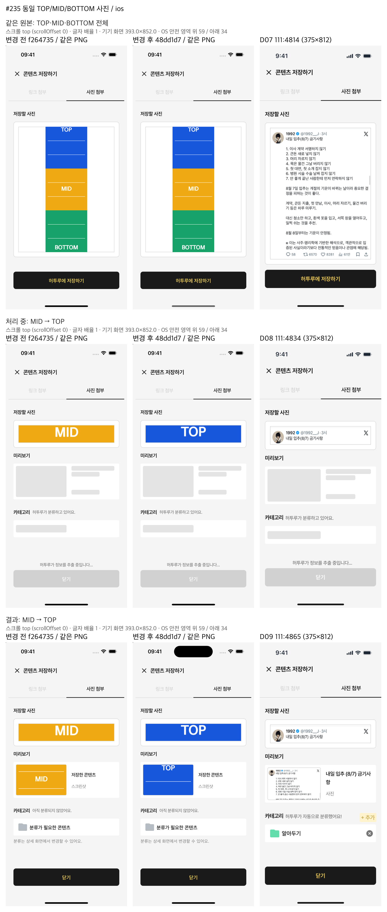
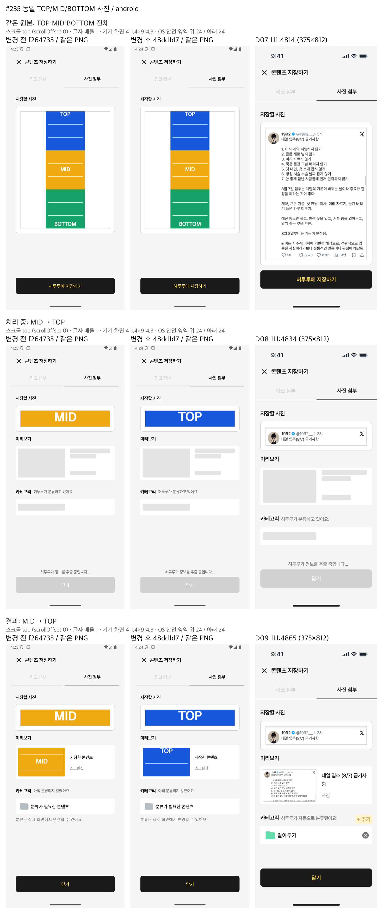
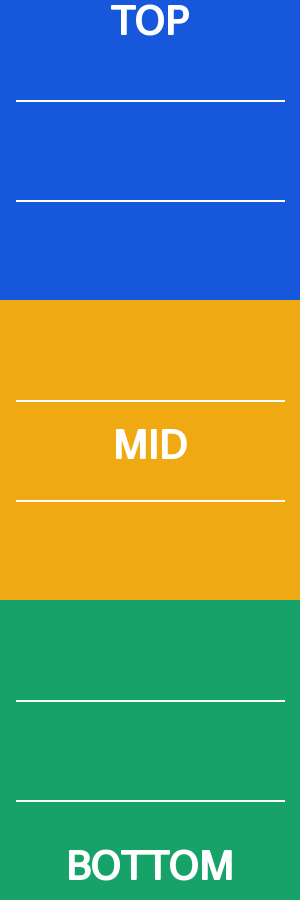

# 사진 저장 응답 지연 뒤 수동 재시도 (#235)

시작 기준: `f264735`. 구현 `a4afedc`, 리뷰 반영 `48dd1d7` 기준으로 전체 검사와 양 플랫폼 변경 후 촬영을 마쳤다. 사용자가 2026-11-05 “승인”으로 시각 판정과 PR 초안을 승인했으며, 아래 병합 후 전체 검사 결과를 포함해 push·PR을 진행한다.

## 사용자 결정

> 59는 1번으로 하면 될 것 같고

> 59 추천대로

승인된 추천: “새 화면 없이 먼저 고치기. 같은 사진을 다시 저장하면 같은 제출 키를 보내서, 서버가 이미 저장된 것을 돌려주게 합니다. 화면은 지금 있는 것만 씁니다. 지연 안내는 지금 토스트 그대로, 성공하면 지금 저장 결과 화면입니다. 자동 재확인과 안내 화면은 디자인을 받은 뒤 별도로 합니다.”

2026-11-05 추가 결정(사진 잠금·썸네일 정렬):

> 사진을 선택한 창에서는 사진을 변경할 수 있고 허투루에 저장하기 버튼을 눌렀을 때는 변경할 수 없게하면 될 것 같아 굳이 디자인은 따로 필요 없을 것 같고 허투루에 저장하기를 누른 후에 나오는 화면에 나오는 스크린샷 썸네일은 가장 상단을 보도록 하면 좋을 것 같아

## 변경

사진 저장 화면이 제출 키를 보유하고 callback → view model → action → repository → API로 전달한다.
같은 사진의 수동 재시도와 인증 갱신은 같은 키를 유지하고, 다른 사진 선택 또는 화면 재진입은 새 키를 쓴다.
서버의 기존 계정별 처리 기록과 잠금을 재사용하며 서버 제품 코드·DB 스키마는 변경하지 않는다.
요청 진행 중 사진 선택을 막고 실패 뒤 해제한다. 처리 중·결과 썸네일은 크기·위치를 유지한 채 상단을 보여 준다.
화면 이탈의 요청 scope와 계정 경계를 확인하여 늦은 응답의 성공 효과를 차단한다. 홈은 같은 ID를 중복 삽입하지 않는다.
손상·누락 응답은 성공으로 표시하지 않으며 기존 지연 토스트·결과 화면·빈 OCR 정책을 유지한다.

기존 고정 테스트의 대기 중 재선택 횟수는 사용자 결정에 따라 2에서 1로 변경했다.
실패 후 사진 변경 테스트는 선택을 실패 뒤로 옮기고, 늦은 picker 테스트는 picker 시작을 제출 전으로 옮겨 기존 기대값을 유지했다.
사진 처리 중·결과 정렬 기대값만 상단으로 변경했고 크기·위치·선택 전 미리보기 단언은 유지했다.
선택적 callback 인자 추가에 따른 테스트·프리뷰 fixture 연결과 사진 응답 fixture의 원본 asset 보완 외 기존 단언은 변경하지 않았다.


## 검수와 회귀 검사 반영

단일 이슈의 티켓 리뷰로 최종 리뷰를 대신했다. `.utmp/review-235.md`는 Standards 0건, Spec 중간 S1 1건이다.
S1의 thumbnail-only 또는 screenshot ID 0인 응답이 성공하는 실패를 재현하고, 원본 screenshot 존재와 모든 asset ID가 양수인지 검사하도록 보완했다.
관련 8개 red 재현 뒤 부분 96개, D08 정합성 보완 뒤 104개가 통과했다.

첫 전체 검사는 D08의 과거 중앙 정렬·요청 중 재선택 기대값으로 앱 8개가 실패했다.
최신 사용자 결정에 따라 `photo_pending_alignment_test.dart`의 잠금 기대값과 공유 `photo_pending_fixture.dart`의 상단 정렬·정상 asset 응답만 갱신했다.
테스트 이름과 나머지 단언은 유지했다. 첫 실패 로그는 `.utmp/ticket-235/verify-result.txt`와 같은 폴더의 로그에 보존했다.

## 전체 검사(최종)

2026-11-05 사용자 승인 뒤 `origin/main`의 #233 `6c9c668`을 병합한 뒤 테스트 콜백 서명을 연결한 `64a8e20`과 동일한 제품·테스트 코드에서 다시 실행했다.
실행 전 `~/.heoturu-agents/busy.sh --wait`가 idle임을 확인했다(첫 실행 13:01:32 KST, 실패 보완 뒤 13:08:13 KST 재확인).
저장소 루트에서 `~/.heoturu-agents/busy.sh && python3 ~/.heoturu-agents/verify.py --log-dir .utmp/ticket-235/post-merge-final`을 600초 제한으로 실행했다.

```text
VERIFY result=PASS scope=all checks=11 failed=0 logs=/Users/leehyeongyu/orca/workspaces/Clipback/photo-save-timeout/.utmp/ticket-235/post-merge-final
```

감독이 `verify-result.txt`와 실제 단계별 로그를 직접 대조했다.
Flutter `app-test.log`: `02:22 +2897: All tests passed!`.
Backend `backend-pytest.log`: `2048 passed, 46 skipped, 3 warnings in 167.72s (0:02:47)`.
분석·포맷·정적 검사 등 11개 단계가 통과했다. skip 사유는 결과 파일 원문을 유지한다.

```text
pytest skip: 45 tests/deployment (RUN_DOCKER_RECOVERY_TESTS=1 and a labelled local image are … 외 6종)
pytest skip: 1 tests/integration (CLIPBACK_IMAGE_TEST_S3_ENDPOINT is required for the local s…)
```

Docker 복구·실제 S3 실행 증거가 아니며 원격 CI 결과는 PR에서 별도 확인한다.
병합 직후 첫 실행은 #233이 새로 추가한 `phone_width_test.dart`의 대역 함수가 #235의 선택적 `submissionKey` 인자를 받지 못해 analyze와 해당 테스트 컴파일에서 실패했다.
이 대역 함수의 인자만 추가하고 테스트 이름·기대값은 유지했다. `frontend/`에서 `flutter test --no-pub test/phone_width_test.dart` 부분 검사 360개가 통과한 뒤 전체 검증을 다시 실행했다.
첫 실패 결과·로그는 `.utmp/ticket-235/post-merge/`, 최종 결과는 `.utmp/ticket-235/post-merge-final/`에 각각 보존했다.
이전 `48dd1d7` 기준 전체 PASS는 `.utmp/ticket-235/s1-final/`에 보존했고, 현재 최종 검증 기준은 위 병합 코드다.

별도 부분 서버 검사 47개는 실제 임시 PostgreSQL DB와 독립 연결의 동시 제출, commit 응답 유실, 기존 결과 재사용, 다른 입력 409·삭제된 결과 410, 원본 한 개와 빈 OCR 정책을 확인했다.
서버 제품 코드·스키마를 바꾸지 않았고 기존 키 없는 앱 0.4.0 계약을 유지했다. OCR은 대역, S3는 moto이며 운영 제공자 검증과 구분한다.

## 최종 화면 검증

2026-11-05 변경 전 `f264735`에서 먼저 촬영하고 변경 후 `48dd1d7`에서 같은 상태를 촬영했다.
변경 전 일반 흐름은 02:40–02:54 KST, 세로 사진 추가 촬영은 03:19–03:24 KST이며 변경 후 촬영은 04시대에 완료했다.
각 빌드·기기 사용 전 busy 대기를 거쳤고 iOS 다음 Android 순서로 실행했다. 종료 뒤 두 기기를 끄고 idle을 확인했다.

| 플랫폼 | 기기·OS | 논리 화면 | OS 안전 영역 위/아래 |
| --- | --- | --- | --- |
| iOS | iPhone 16 Simulator, iOS 18.6 | 393×852 | 59/34 |
| Android | Medium_Phone Emulator, Android 16 API 36 | 411.4286×914.2857 | 24/24 |

일반 흐름은 양 플랫폼의 앱 글자 배율 1.0·1.3에서 사진 선택 → 실제 10초 응답 제한 → 기존 지연 토스트 → 기존 저장 버튼으로 수동 재시도 → 결과 화면을 확인했다.
추가 세로 사진은 배율 1.0에서 처리 중·결과 썸네일을 확인했다. 현재 비교 자료는 아래 재촬영 절의 TOP/MID/BOTTOM 글자가 있는 같은 300×900 PNG를 사용한다.
스크롤은 모두 맨 위다. 배율은 앱 MediaQuery 기준이며 OS 배율을 바꾼 검사가 아니다.

실제 ClipbackApp에 FilePicker·HTTP 대역을 연결하고, 최초 요청을 보류한 뒤 timeout 후 서버 대역을 완료시켜 재시도했다.
Orca 실제 탭으로 요청 중 사진을 눌러도 picker 호출이 1회로 유지됨을 확인했고, AX 문구·상태 JSON·전환 영상을 함께 남겼다.
여섯 변경 후 흐름에서 지연 안내는 최초 요청 뒤 10,067–10,191ms에 나타나며 잠금이 풀렸다.
두 요청은 같은 비어 있지 않은 키를 사용하고 records=[700] 한 건, result=true, unexpected=[]였다.
변경 전에는 키 없는 두 요청이 records=[700,701] 두 건을 만들었다. 이는 로컬 대역 증거이며 실제 DB 보장은 위 PostgreSQL 검사로 별도 확인했다.
하네스 사전 위젯 검사 2개는 결과 닫기·상세 뒤로가기 후 홈에 ID 700이 한 번 나타나는 것까지 통과했다.

처리 중·결과 썸네일은 같은 원본의 중앙 MID에서 상단 TOP으로 바뀌었고 크기·위치는 유지했다. 선택 화면 미리보기는 기존 전체 사진 표시를 유지했다.
일반 결과는 빈 OCR의 기존 기본 제목·요약·미분류이며 Figma의 예시 콘텐츠와 다르다.
변경 전·후의 기종·화면 크기·글자 배율·안전 영역·스크롤을 대조해 비교 이미지를 생성했다.
Android 지연 토스트는 원본 영상의 toast=true 기록 +0.6초 프레임으로 보완했다. 추출 시점 JSON과 늦게 찍힌 원본 PNG 모두 보존했다.

Figma 파일 `svNWsTFh8Ws1Mpt8XQIcrN`의 D07 `111:4814`(04:06 KST), D08 `111:4834`(03:22 KST), D09 `111:4865`(02:42 KST)를 2026-11-05 조회했다.
기준 프레임은 375×812이며 기기별 화면·안전 영역 차이는 비교 행에 명시했고 원본을 보정하지 않았다.
지연 토스트 대응 신규 디자인은 적용하지 않았으며 빈 Figma 칸에 대체 화면을 만들지 않았다. 썸네일 상단 정렬은 위 사용자 결정이 기준이다.

| 증거 | 저장소 루트 기준 로컬 경로 |
| --- | --- |
| 일반 변경 전·후·Figma | `.utmp/ticket-235-screens/compare-ios.png`, `compare-android.png` |
| 처리 중·결과 썸네일 변경 전·후·Figma | `.utmp/ticket-235-screens/compare-ios-thumbnail.png`, `compare-android-thumbnail.png` |
| 일반 1.0·1.3 비교 영상 | `.utmp/ticket-235-screens/compare-ios-flow.mp4`, `compare-ios-1_3-flow.mp4`, `compare-android-flow.mp4`, `compare-android-1_3-flow.mp4` |
| 동일 TOP/MID/BOTTOM 사진 비교 영상 | `.utmp/ticket-235-screens/compare-ios-thumbnail-flow.mp4`, `compare-android-thumbnail-flow.mp4` |
| 원본·상태 기록·진입 파일 | `.utmp/ticket-235/`, `.utmp/ticket-235-thumbnail/`, `.utmp/ticket-235-after/`, `.utmp/ticket-235-thumbnail-after/` |
| 조건·요청·해시 대조 | `.utmp/ticket-235-screens/evidence-audit.json`, `labelled-evidence-audit.json` |

비교 영상은 원본 마지막 프레임과 합성 영상 끝 장면을 검사하고 장면 미리보기를 직접 확인했다.
자동 검사와 감독 확인 뒤 2026-11-05 사용자가 시각 판정을 승인했다. 아래 main 병합과 겹치는 전체 폭 변경은 재촬영 없이 기록하라는 사용자 지시를 따랐다.

## 남은 결정과 한계

- 사용자가 시각 판정과 PR 초안을 승인했다. `.utmp/pr-235-draft.md` 본문으로 push·PR을 진행하며, 이미지 자리는 사용자가 PR 편집 화면에 끌어다 놓는다.
- 승인 뒤 fetch한 `origin/main`의 #233 `6c9c668`을 `534df05`로 충돌 없이 병합하고 전체 검증을 다시 마쳤다. 승인된 화면은 병합 전 `48dd1d7` 기준이며 변경하지 않았다.
- 원격 CI는 PR 생성 뒤 시작을 확인하며 로컬 결과와 구분한다. 운영 서버·실제 OCR/S3 제공자·실기기는 이번 범위 밖이며 실행하지 않았다.
- 기존 `frontend/test/support/photo_pending_preview.dart`의 요청 중 재선택 시나리오는 새 사용자 결정과 맞지 않는다. 촬영 파일 수정 금지 범위로 보존하고 이번 촬영에는 별도 감독 하네스를 사용했다. 공유 fixture를 쓰는 `image_storage_live_preview.dart`는 picker 타입만 가져오며 영향 없는 것을 확인했다.
- 네이티브 공유의 별도 응답 파서는 assets를 확인하지 않는다. 이번 본앱 사진 저장 범위 밖의 코드 관찰이며 재현된 실패로 보고하지 않는다.


## 썸네일 위치를 글자로 확인하는 재촬영 (2026-11-05)

사용자 요청으로 색만 보이던 썸네일 비교를 TOP/MID/BOTTOM 글자가 있는 사진으로 교체했다.
기존 사진도 변경 전·후의 바이트가 같았지만 잘린 색만으로는 위치를 확인하기 어려웠다.
새 비교의 첫 행은 양쪽에 같은 전체 원본, 둘째 행은 처리 중, 셋째 행은 결과 화면이다.
iPhone 16 iOS 18.6와 Medium_Phone Android 16 모두 변경 전에는 **MID**, 변경 후에는 **TOP**이 처리 중·결과 썸네일에서 읽히는 것을 원본 스크린샷으로 직접 확인했다.
위젯 크기·위치, 글자 배율 1.0, 스크롤 0과 OS 안전 영역은 동일하다. Figma는 앞서 확보한 D07·D08·D09 원본을 재사용한다.

현재 비교 이미지도 이력과 함께 커밋했다. 각 열은 변경 전·변경 후·Figma 순서다.

| iOS | Android |
| --- | --- |
| [원본 크기로 보기](assets/photo-save-235-compare-ios.png) | [원본 크기로 보기](assets/photo-save-235-compare-android.png) |
|  |  |

원본 파일: [photo-save-235-top-mid-bottom.png](assets/photo-save-235-top-mid-bottom.png) (300×900, 7,958 bytes).
SHA-256: `03c98e90d757eae9ca525080ffa2e7b1185e9ba81d9d2188d1be6813b3208100`.



사진은 아래 코드로 생성했다(Python 3, Pillow 12.2.0의 내장 글꼴, 저장소 루트에서 실행).
기기 캡처나 비교 화면을 그려 만든 것이 아니라 파일 선택 대역이 실제 앱에 전달하는 입력 PNG다.

```python
from pathlib import Path
from PIL import Image, ImageDraw, ImageFont

asset = Path("docs/history/assets/photo-save-235-top-mid-bottom.png")
asset.parent.mkdir(exist_ok=True)
im = Image.new("RGB", (300, 900))
d = ImageDraw.Draw(im)
font = ImageFont.load_default(size=40)
for y, color in [(0, "#1757db"), (300, "#efaa13"), (600, "#16a268")]:
    d.rectangle((0, y, 299, y + 299), fill=color)
for label, y in [("TOP", 5), ("MID", 430), ("BOTTOM", 850)]:
    box = d.textbbox((0, 0), label, font=font)
    d.text(((300 - box[2]) / 2, y - box[1]), label,
           font=font, fill="white", stroke_width=1)
for y in [100, 200, 400, 500, 700, 800]:
    d.line((16, y, 284, y), fill="white", width=2)
im.save(asset)
```

두 진입 파일의 base64를 디코딩해 원본 PNG와 바이트 단위로 대조했다.
iOS kernel_blob.bin과 Android APK 안 kernel_blob.bin에도 같은 PNG 리터럴이 들어 있는지 확인하고, 설치 도구의 빌드 해시 대조를 거쳤다.
네 실행의 ready/processing/result JSON에 같은 원본 해시·길이가 기록됐으며 unexpected=[]였다.
BEFORE는 시작 커밋 `f264735`의 앱 파일로 일시 복원해 빌드한 뒤 현재 파일을 복구했고 AFTER의 제품 코드는 `48dd1d7`과 같다.
각 진입 파일 사전 테스트 1개씩, iOS·Android 변경 전/후 빌드 4개, 실제 촬영 4흐름이 통과했다.
변경 전 대역 저장은 두 건, 변경 후는 동일 키의 한 건이며 새 사진으로도 재현 흐름을 확인했다.
모든 빌드·기기 사용은 busy 대기 후 순차 실행했고 종료 뒤 기기를 껐다.

새 진입 파일·원본 스크린샷·상태·영상·빌드 로그는 `.utmp/ticket-235-labelled-before/`와 `.utmp/ticket-235-labelled-after/`에 있다.
비교 결과는 앞 표의 `compare-{ios,android}-thumbnail.png`와 `compare-{ios,android}-thumbnail-flow.mp4`를 새 결과로 교체했다.
이전 색 영역만 있던 비교는 `.utmp/ticket-235-screens/previous-color-only/`에 보존했다.
새 영상도 끝 프레임 검사를 통과했고 장면 미리보기를 직접 확인했다.
사진·앱 빌드·스크린샷 해시는 `.utmp/ticket-235-screens/labelled-evidence-audit.json`, 실행 로그는 `.utmp/ticket-235-labelled-{ios,android}-console.log`에 있다.

별도 일반 재시도 비교(`compare-ios.png`, `compare-android.png`, 1.0/1.3배 영상)는 변경 전·후에 동일한 70-byte PNG를 사용했음을 다시 확인했다.
그 SHA-256은 `c414cd0e204de974f73753c7e28d7638e7b3691bb8b1a2bab6b25bb7fed7ce77`이며 이번에 사진이나 기존 결과를 바꾸지 않았다.
입력 대조 기록은 `.utmp/ticket-235-labelled-input-audit.json`이다.
재촬영 단계는 시험 사진·촬영 자료·문서만 바꿔 전체 VERIFY를 반복하지 않았다. 이후 사용자 승인 뒤 main을 병합한 검증은 위 “전체 검사(최종)”에서 새 결과로 갱신했다.


## 사용자 승인 뒤 main 병합 (2026-11-05)

사용자 원문: “승인”. 화면 판정과 `.utmp/pr-235-draft.md`를 승인하고 push·PR 생성을 지시했다.
fetch 뒤 `HEAD..origin/main`은 #233 `6c9c668` 한 건이었으며 기존 PR 조회는 빈 목록이었다.
`git merge origin/main -m "merge: main의 #233 반영 (#235)"`로 `534df05`를 만들었고 충돌은 없었다.
CHANGELOG와 이력 목차의 양쪽 추가 항목이 보존된 것을 확인했다.

#233은 `save_content_screen.dart` 저장 시트의 고정 최대 폭 375를 `appContentWidth(MediaQuery.sizeOf(context).width)`로 바꾼다.
논리 폭 600 미만 휴대폰의 전체 폭을 쓰므로 #235가 촬영한 393/411.4 폭 화면과 겹친다.
사용자 지시대로 이 사실만 기록하고 승인된 비교 이미지·영상을 그대로 뒀다. 병합 후 화면을 재촬영하거나 동일하다고 주장하지 않는다.
승인 미디어 SHA-256 목록 `.utmp/ticket-235/post-merge/approved-media-sha256.json`과 실제 파일을 대조해 변경 없음을 확인했다.
최종 전체 검증은 병합 코드에서 재실행했고 위 결과와 PR 초안의 VERIFY 줄을 같은 push에 포함한다.
